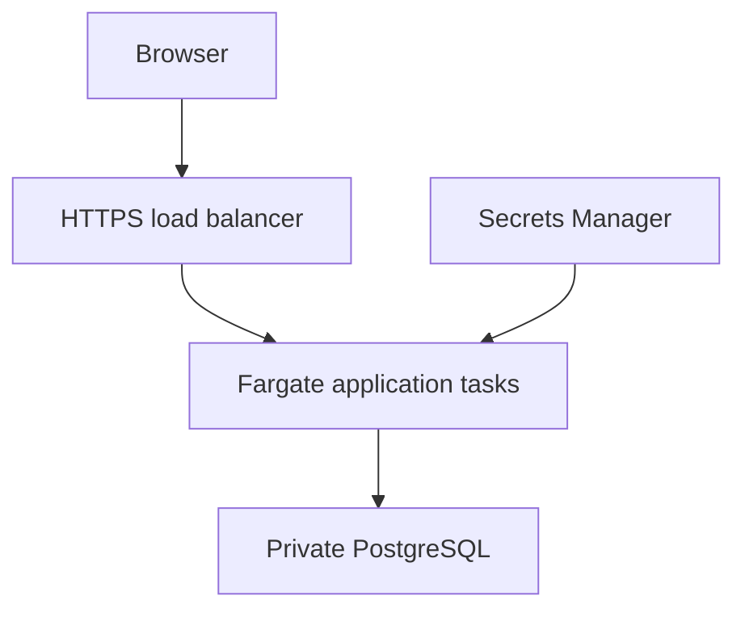

# Cloud Task Lab

Four assignment projects in one runnable Python application, prepared for Kaden Diaz. Each project has its own interface, demonstration procedure, and acceptance checks. Shared authentication, storage, and deployment keep setup manageable.

**Start with [START_HERE.md](START_HERE.md).** It contains the complete Windows setup process. No AWS account, credit card, Docker, Node, or API key is needed for the local labs.

| Project | Working implementation | Walkthrough |
|---|---|---|
| 1. Data redundancy removal | Canonicalization, content fingerprints, database uniqueness, conflict detection, explicit false-positive review | [Task 1](docs/task-1-records.md) |
| 2. SQL injection protection | Bound SQL, scoped capability tokens, account ownership checks, AES-256-GCM, scrypt, security event logging | [Task 2](docs/task-2-security.md) |
| 3. Cloud bus passes | Server-controlled fares, atomic seat reservations, idempotent requests, recoverable signed passes, cancellation | [Task 3](docs/task-3-passes.md) |
| 4. Retrieval chatbot | TF-IDF/cosine retrieval, curated support patterns, source labels, uncertainty fallback, website integration | [Task 4](docs/task-4-chat.md) |

## Verification and deployment status

- **31 automated application checks passed** using Python 3.12 and a temporary SQLite database. Includes concurrent booking, concurrent duplicate insertion, authorization, encryption, and injection cases.
- **25/25 development chatbot cases matched the expected intent or fallback.** This is a small tuned development set, not an independent accuracy benchmark.
- **CloudFormation static validation passed** with cfn-lint. This checks the template, not a running AWS environment.
- **Browser automation is provided but was blocked in the build environment** by an OS permission restriction on Chromium's socket creation. No visual or browser-pass claim is made.
- **AWS deployment, live PostgreSQL behavior, real load scaling, and Windows execution remain to be verified on the target systems.** No AWS resources were created. The application was tested on Linux; Windows commands are supplied for reproduction.

See [requirements and evidence](docs/requirements-and-evidence.md) for the full requirement mapping and [security limitations](docs/security-and-limitations.md) for the intended scope.

## Architecture

Local: browser → Waitress/Flask → SQLite file. Sensitive values are encrypted by the application before storage; the local key lives in an ignored `.env` file.

Cloud configuration: HTTPS Application Load Balancer → 2–4 ECS Fargate tasks → private RDS PostgreSQL. Secrets Manager supplies keys and passwords. A separate initialization container owns schema creation; the web database role has data access without schema ownership. CPU target tracking changes application task count. RDS Multi-AZ is optional; it is disabled by default to reduce lab cost.

Cloud deployment is billable and requires an authorized AWS account, Docker, an owned hostname, and an issued regional ACM certificate. Use [the complete AWS guide](docs/cloud-deployment.md) when those are available.

## Repository layout

- `suite/`: backend, retrieval model, schema, website assets.
- `tests/test_suite.py`: automated application checks.
- `tests/browser_smoke.cjs`: optional browser verification and screenshot capture.
- `cloud/`: generated CloudFormation, generator, public RDS certificate bundle.
- `docs/`: four demonstrations, cloud implementation, troubleshooting, publishing, evidence.
- `evidence/`: test outputs from this build; no customer data or private keys.
- `setup_local.py`: generates a private local encryption secret without replacing an existing one.
- `manage.py`: local administrator promotion and fictional route date maintenance.

The four tasks are integrated modules in one repository. If the assignment requires four separate submissions, submit the relevant module, walkthrough, and shared infrastructure references for each; confirm any instructor-specific packaging rule.
